# ESP32 Workshop

**Explore 50 hands-on ESP32 lessons, from your first GPIO circuit to connected IoT projects.**

[Open the live ESP32 Workshop](https://esp32.itgg.space)

## About

ESP32 Workshop is an interactive learning experience for understanding microcontrollers, circuits, sensors, displays, motors, wireless communication, and IoT security. Each lesson pairs a 3D ESP32 workspace with a concise guide and an experiment to explore.

Created by **Geevarghese K Thomas**. Visit the [live workshop](https://esp32.itgg.space) to explore the lessons in your browser.

This repository is a visual lesson guide: it includes lesson explanations and screenshots, and does not include project source code or Arduino materials.

## Preview

## What you’ll learn

- ESP32 GPIO, analog inputs, PWM, and circuit basics
- LEDs, buttons, buzzers, displays, motors, and common sensors
- Wi-Fi, Bluetooth, ESP-NOW, HTTP, and MQTT
- IoT reliability, credential handling, TLS, and firmware security
- Projects such as a sensor dashboard, smart mailbox, plant watering scheduler, and weather station

## All 50 lessons

Each image shows the ESP32 workshop with that lesson selected. Select a screenshot to open the full-size image.

| Lessons 1–17 | Lessons 18–34 | Lessons 35–50 |
|---|---|---|
| <a href="screenshots/lessons/01-board.jpg">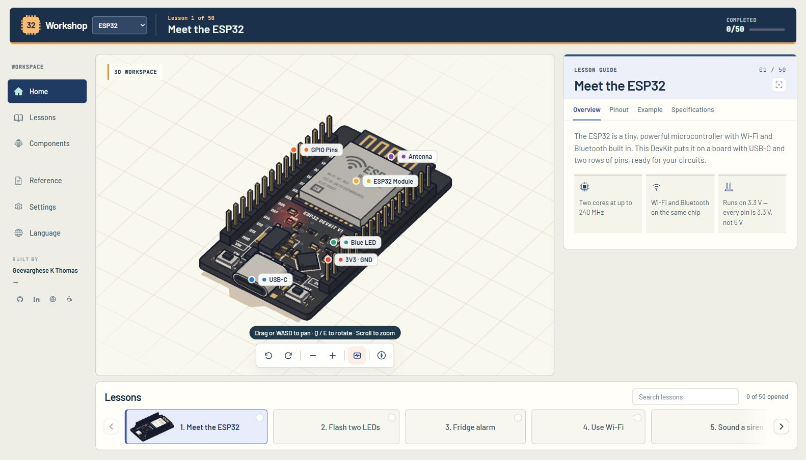</a> <strong>01. Meet the ESP32</strong> The ESP32 is a tiny, powerful microcontroller with Wi-Fi and Bluetooth built in. This DevKit puts it on a board with USB-C and two rows of pins, ready for your circuits. | <a href="screenshots/lessons/02-blink.jpg">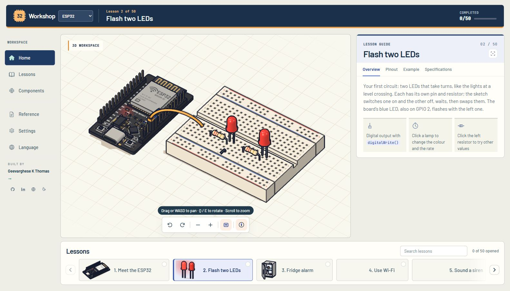</a> <strong>02. Flash two LEDs</strong> Your first circuit: two LEDs that take turns, like the lights at a level crossing. Each has its own pin and resistor; the sketch switches one on and the other off, waits, then swaps them. The board’s blue LED, also on GPIO 2, flashes with the left one. | <a href="screenshots/lessons/03-button.jpg">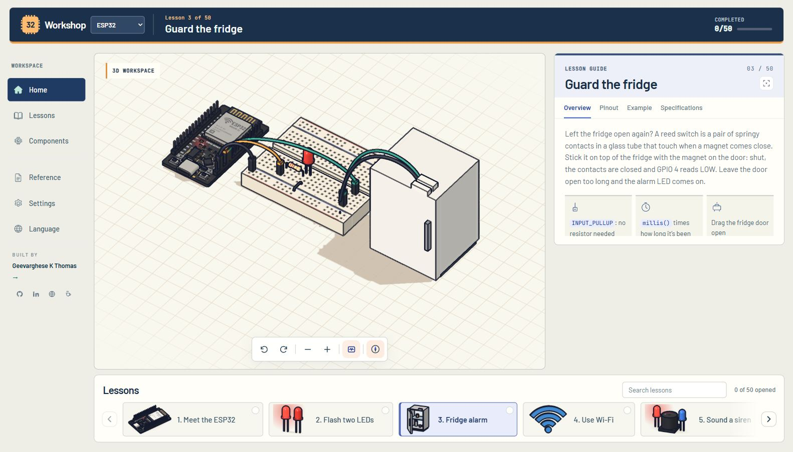</a> <strong>03. Guard the fridge</strong> Left the fridge open again? A reed switch is a pair of springy contacts in a glass tube that touch when a magnet comes close. Stick it on top of the fridge with the magnet on the door: shut, the contacts are closed and GPIO 4 reads LOW. Leave the door open too long and the alarm LED comes on. |
| <a href="screenshots/lessons/04-wifi.jpg">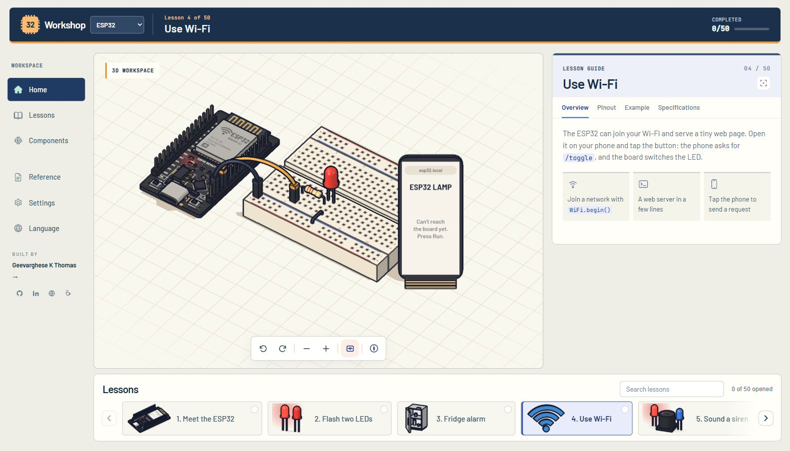</a> <strong>04. Use Wi-Fi</strong> The ESP32 can join your Wi-Fi and serve a tiny web page. Open it on your phone and tap the button: the phone asks for <code>/toggle</code>, and the board switches the LED. | <a href="screenshots/lessons/05-sound.jpg">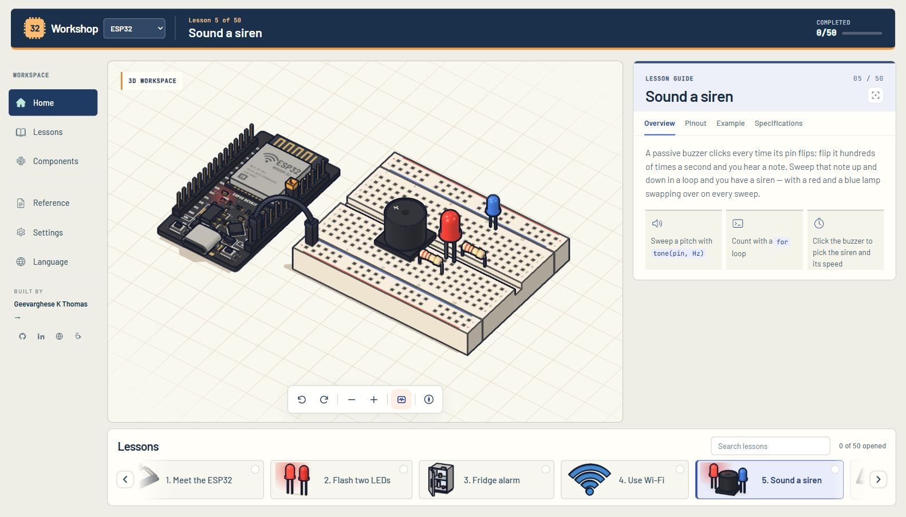</a> <strong>05. Sound a siren</strong> A passive buzzer clicks every time its pin flips; flip it hundreds of times a second and you hear a note. Sweep that note up and down in a loop and you have a siren — with a red and a blue lamp swapping over on every sweep. | <a href="screenshots/lessons/06-piano.jpg">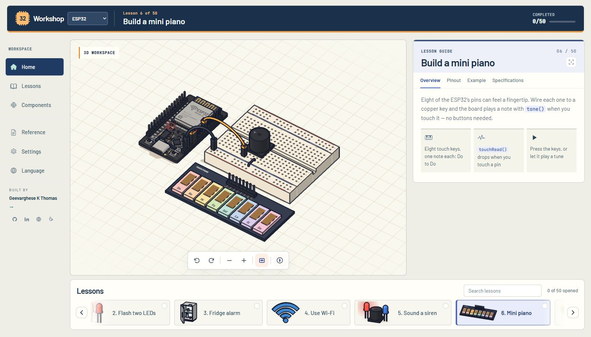</a> <strong>06. Build a mini piano</strong> Eight of the ESP32’s pins can feel a fingertip. Wire each one to a copper key and the board plays a note with <code>tone()</code> when you touch it — no buttons needed. |
| <a href="screenshots/lessons/07-knob.jpg">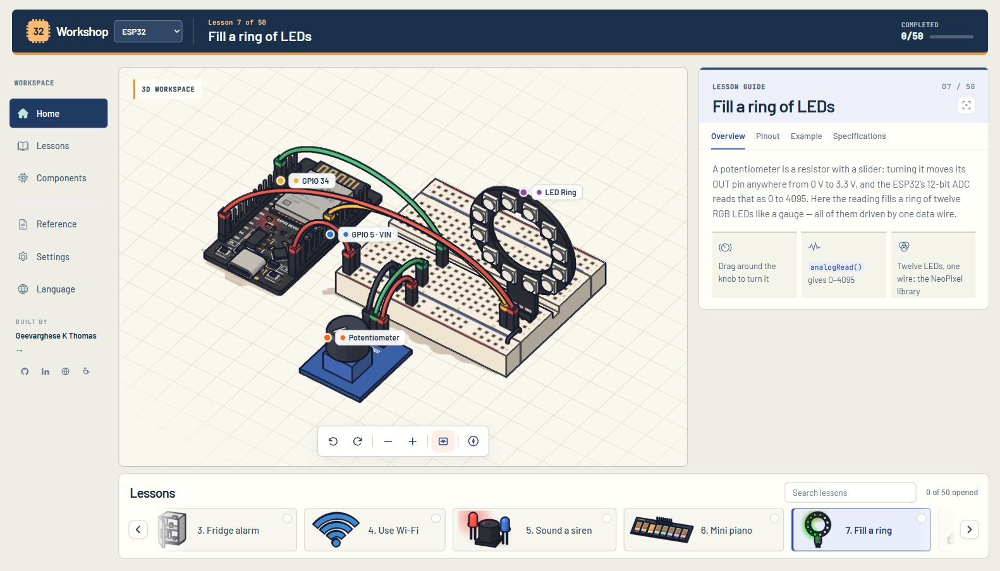</a> <strong>07. Fill a ring of LEDs</strong> A potentiometer is a resistor with a slider: turning it moves its OUT pin anywhere from 0 V to 3.3 V, and the ESP32’s 12-bit ADC reads that as 0 to 4095. Here the reading fills a ring of twelve RGB LEDs like a gauge — all of them driven by one data wire. | <a href="screenshots/lessons/08-rgb.jpg">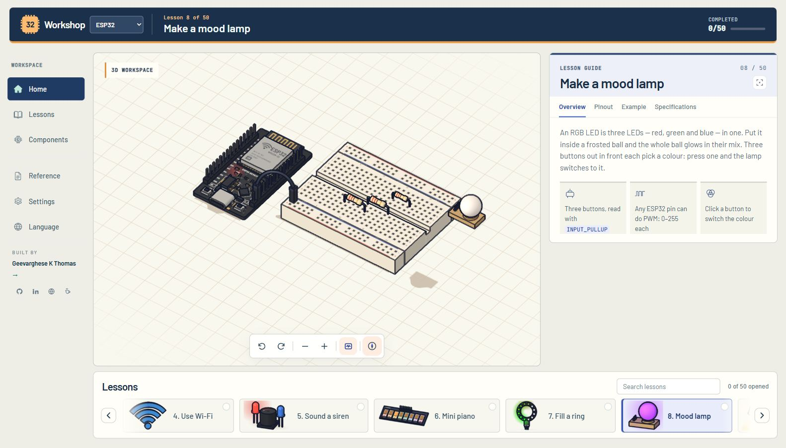</a> <strong>08. Make a mood lamp</strong> An RGB LED is three LEDs — red, green and blue — in one. Put it inside a frosted ball and the whole ball glows in their mix. Three buttons out in front each pick a colour: press one and the lamp switches to it. | <a href="screenshots/lessons/09-light.jpg">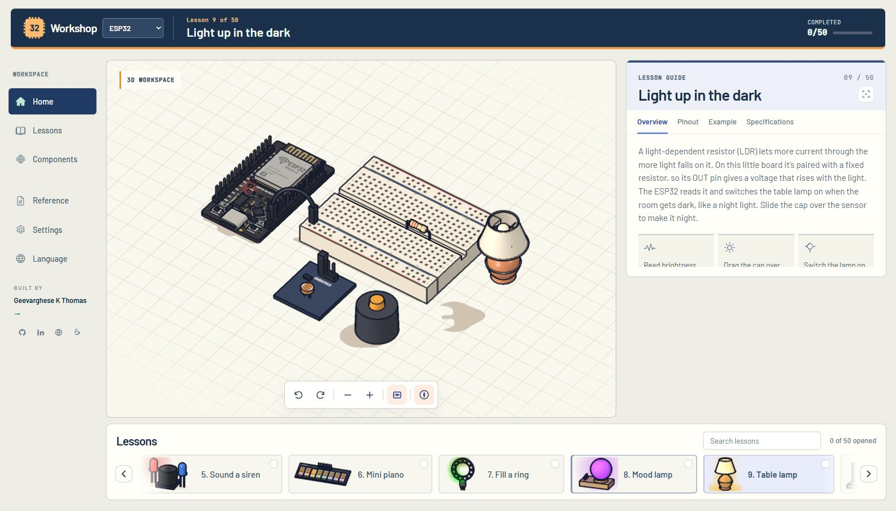</a> <strong>09. Light up in the dark</strong> A light-dependent resistor (LDR) lets more current through the more light falls on it. On this little board it’s paired with a fixed resistor, so its OUT pin gives a voltage that rises with the light. The ESP32 reads it and switches the table lamp on when the room gets dark, like a night light. Slide the cap over the sensor to make it night. |
| <a href="screenshots/lessons/10-sensor.jpg">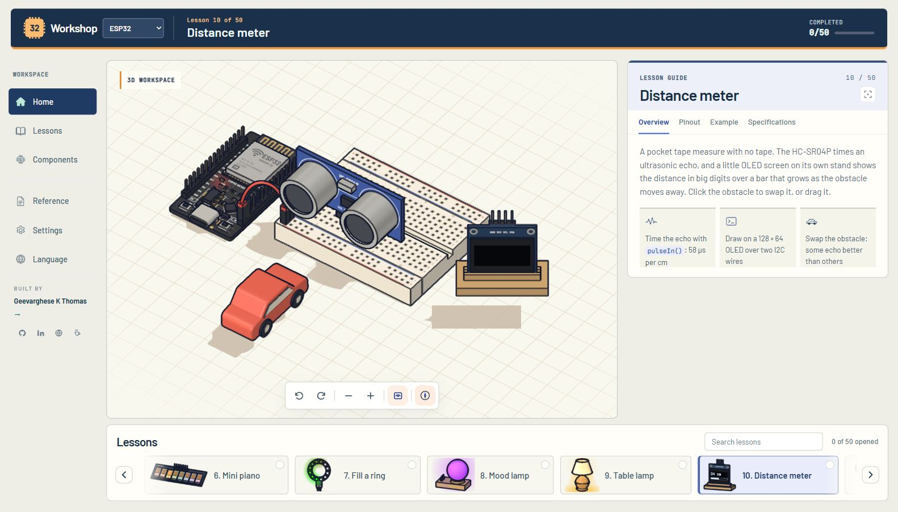</a> <strong>10. Distance meter</strong> A pocket tape measure with no tape. The HC-SR04P times an ultrasonic echo, and a little OLED screen on its own stand shows the distance in big digits over a bar that grows as the obstacle moves away. Click the obstacle to swap it, or drag it. | <a href="screenshots/lessons/11-motor.jpg">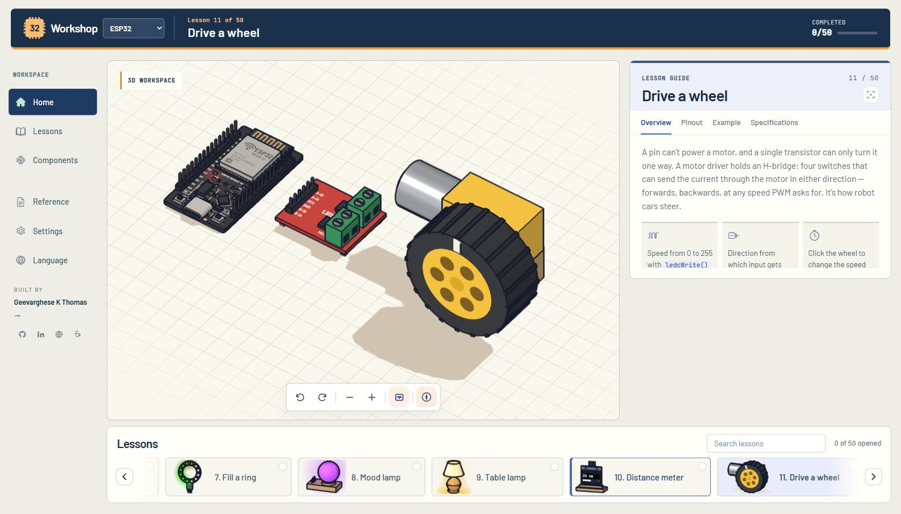</a> <strong>11. Drive a wheel</strong> A pin can’t power a motor, and a single transistor can only turn it one way. A motor driver holds an H-bridge: four switches that can send the current through the motor in either direction — forwards, backwards, at any speed PWM asks for. It’s how robot cars steer. | <a href="screenshots/lessons/12-servo.jpg">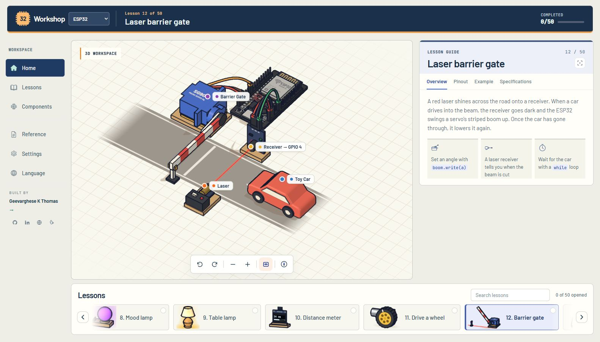</a> <strong>12. Laser barrier gate</strong> A red laser shines across the road onto a receiver. When a car drives into the beam, the receiver goes dark and the ESP32 swings a servo’s striped boom up. Once the car has gone through, it lowers it again. |
| <a href="screenshots/lessons/13-bluetooth.jpg">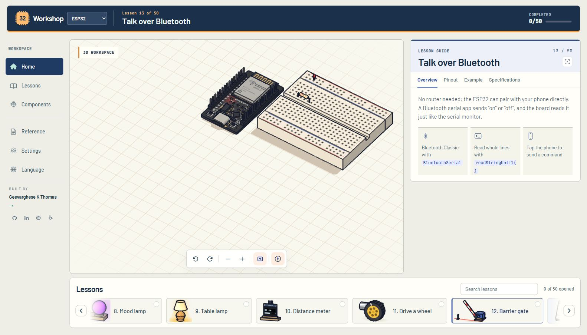</a> <strong>13. Talk over Bluetooth</strong> No router needed: the ESP32 can pair with your phone directly. A Bluetooth serial app sends “on” or “off”, and the board reads it just like the serial monitor. | <a href="screenshots/lessons/14-espnow.jpg">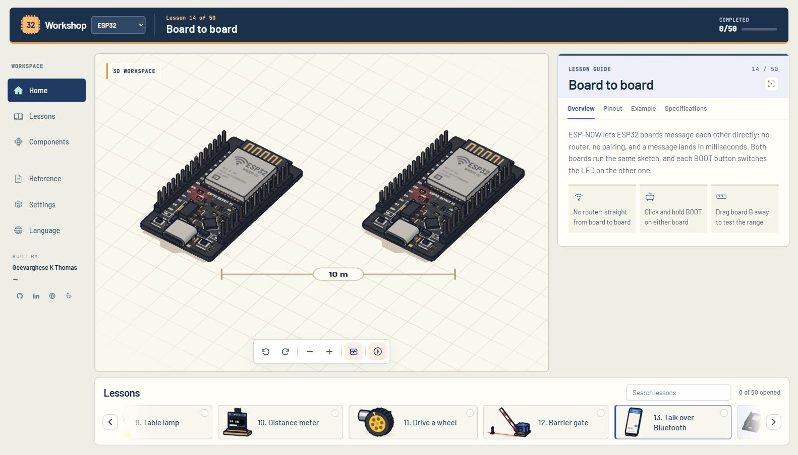</a> <strong>14. Board to board</strong> ESP-NOW lets ESP32 boards message each other directly: no router, no pairing, and a message lands in milliseconds. Both boards run the same sketch, and each BOOT button switches the LED on the other one. | <a href="screenshots/lessons/15-project.jpg">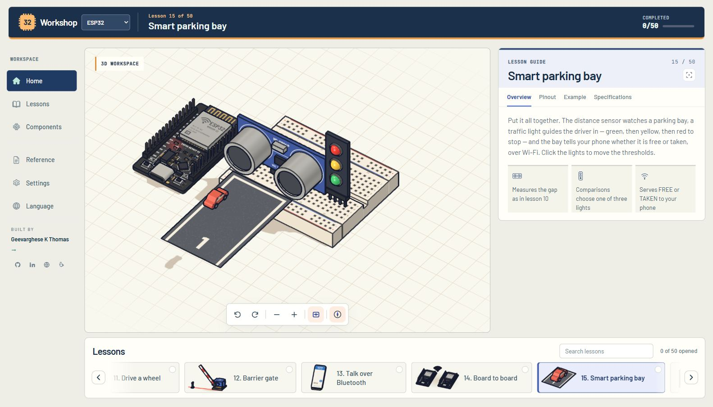</a> <strong>15. Smart parking bay</strong> Put it all together. The distance sensor watches a parking bay, a traffic light guides the driver in — green, then yellow, then red to stop — and the bay tells your phone whether it is free or taken, over Wi-Fi. Click the lights to move the thresholds. |
| <a href="screenshots/lessons/16-pump.jpg">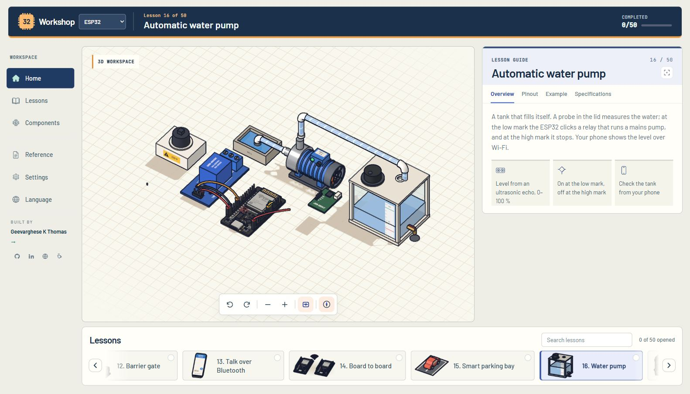</a> <strong>16. Automatic water pump</strong> A tank that fills itself. A probe in the lid measures the water; at the low mark the ESP32 clicks a relay that runs a mains pump, and at the high mark it stops. Your phone shows the level over Wi-Fi. | <a href="screenshots/lessons/17-keypad.jpg">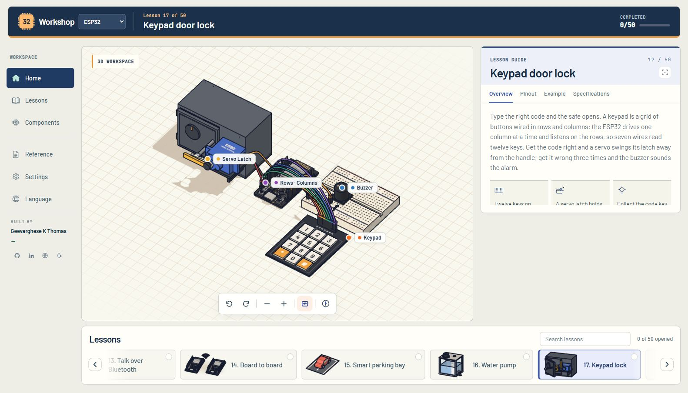</a> <strong>17. Keypad door lock</strong> Type the right code and the safe opens. A keypad is a grid of buttons wired in rows and columns: the ESP32 drives one column at a time and listens on the rows, so seven wires read twelve keys. Get the code right and a servo swings its latch away from the handle; get it wrong three times and the buzzer sounds the alarm. | <a href="screenshots/lessons/18-solar.jpg">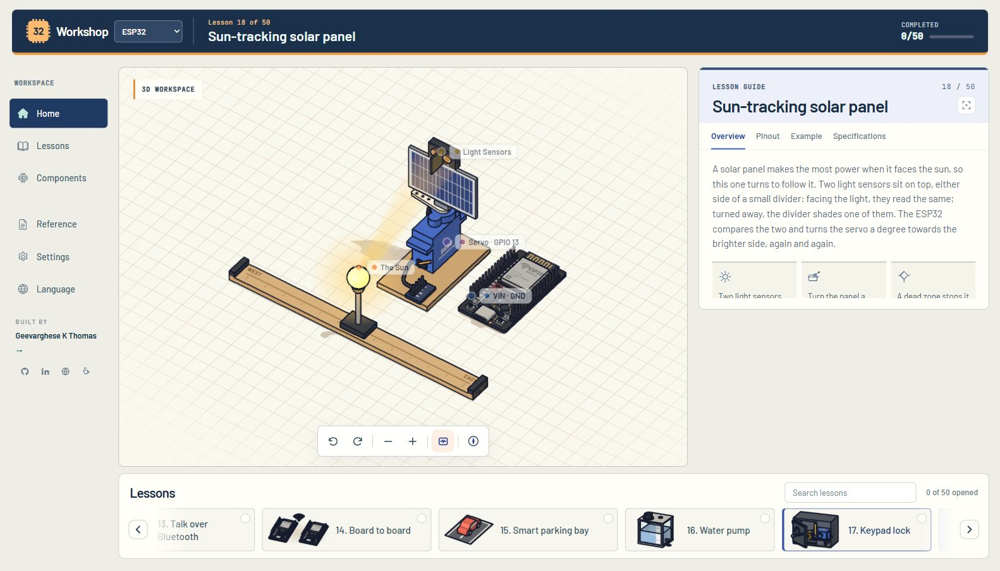</a> <strong>18. Sun-tracking solar panel</strong> A solar panel makes the most power when it faces the sun, so this one turns to follow it. Two light sensors sit on top, either side of a small divider: facing the light, they read the same; turned away, the divider shades one of them. The ESP32 compares the two and turns the servo a degree towards the brighter side, again and again. |
| <a href="screenshots/lessons/19-radar.jpg">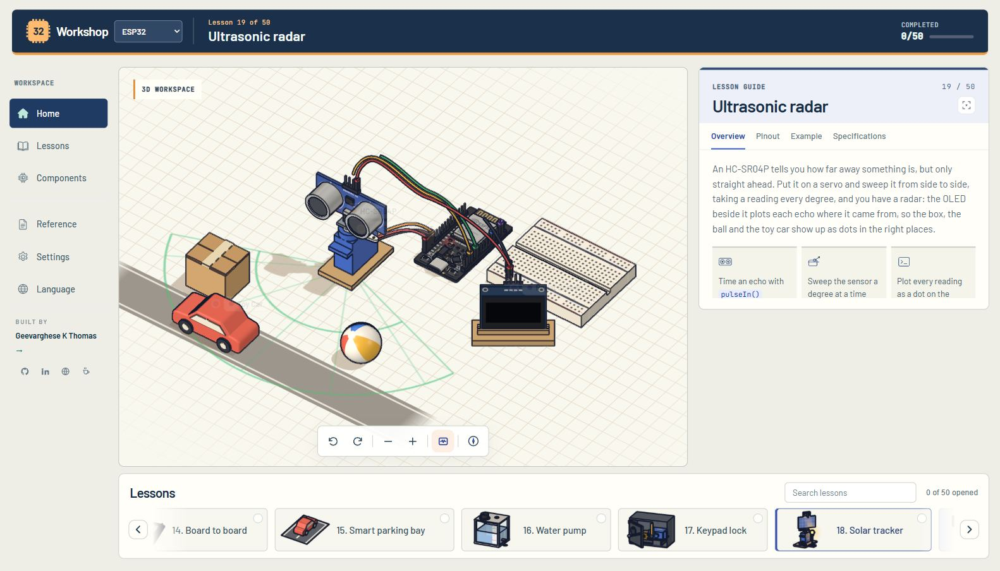</a> <strong>19. Ultrasonic radar</strong> An HC-SR04P tells you how far away something is, but only straight ahead. Put it on a servo and sweep it from side to side, taking a reading every degree, and you have a radar: the OLED beside it plots each echo where it came from, so the box, the ball and the toy car show up as dots in the right places. | <a href="screenshots/lessons/20-stepper.jpg">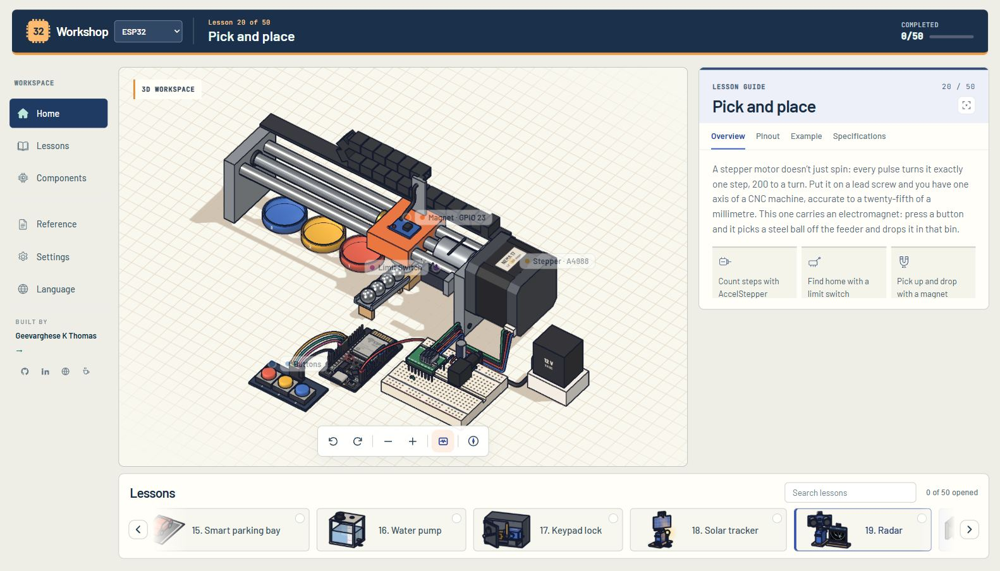</a> <strong>20. Pick and place</strong> A stepper motor doesn’t just spin: every pulse turns it exactly one step, 200 to a turn. Put it on a lead screw and you have one axis of a CNC machine, accurate to a twenty-fifth of a millimetre. This one carries an electromagnet: press a button and it picks a steel ball off the feeder and drops it in that bin. | <a href="screenshots/lessons/21-climate.jpg">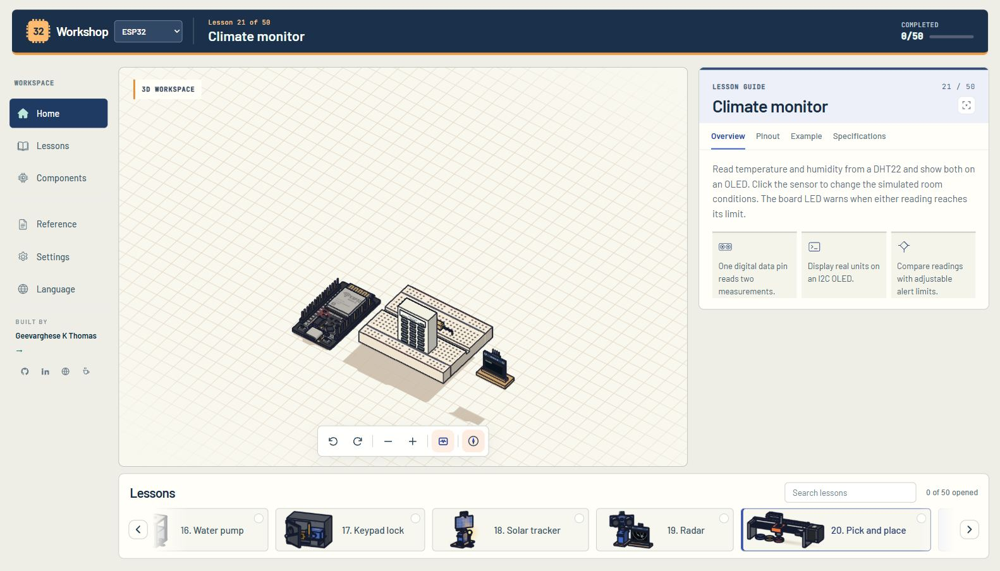</a> <strong>21. Climate monitor</strong> Read temperature and humidity from a DHT22 and show both on an OLED. Click the sensor to change the simulated room conditions. The board LED warns when either reading reaches its limit. |
| <a href="screenshots/lessons/22-motion.jpg">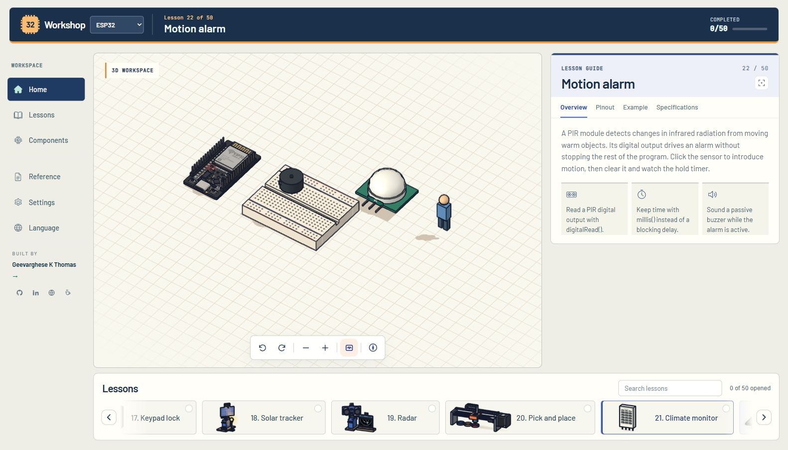</a> <strong>22. Motion alarm</strong> A PIR module detects changes in infrared radiation from moving warm objects. Its digital output drives an alarm without stopping the rest of the program. Click the sensor to introduce motion, then clear it and watch the hold timer. | <a href="screenshots/lessons/23-plant.jpg">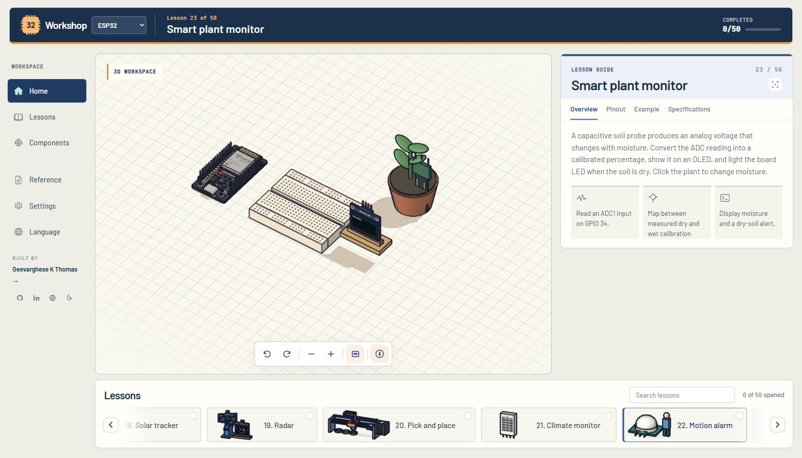</a> <strong>23. Smart plant monitor</strong> A capacitive soil probe produces an analog voltage that changes with moisture. Convert the ADC reading into a calibrated percentage, show it on an OLED, and light the board LED when the soil is dry. Click the plant to change moisture. | <a href="screenshots/lessons/24-encoder.jpg">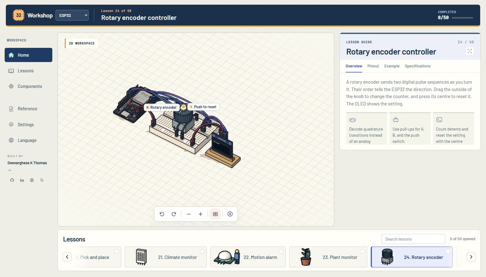</a> <strong>24. Rotary encoder controller</strong> A rotary encoder sends two digital pulse sequences as you turn it. Their order tells the ESP32 the direction. Drag the outside of the knob to change the counter, and press its centre to reset it. The OLED shows the setting. |
| <a href="screenshots/lessons/25-wifi-manager.jpg">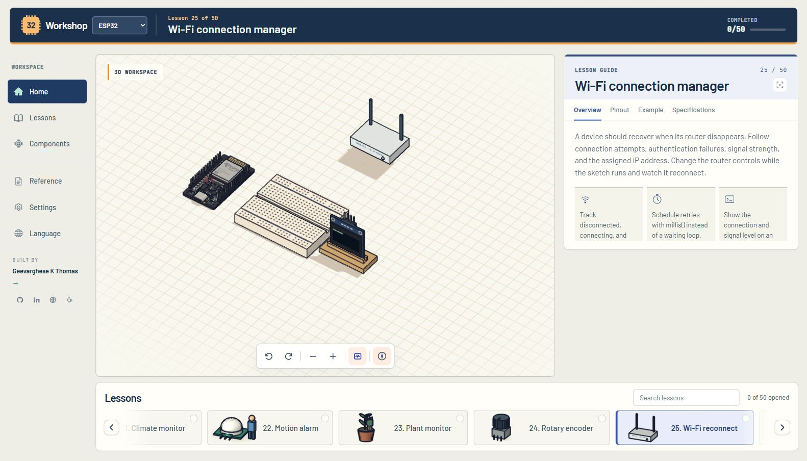</a> <strong>25. Wi-Fi connection manager</strong> A device should recover when its router disappears. Follow connection attempts, authentication failures, signal strength, and the assigned IP address. Change the router controls while the sketch runs and watch it reconnect. | <a href="screenshots/lessons/26-internet-clock.jpg">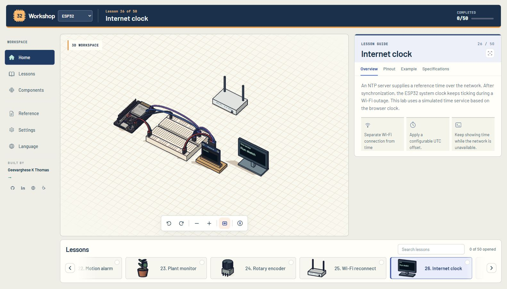</a> <strong>26. Internet clock</strong> An NTP server supplies a reference time over the network. After synchronization, the ESP32 system clock keeps ticking during a Wi-Fi outage. This lab uses a simulated time service based on the browser clock. | <a href="screenshots/lessons/27-sensor-dashboard.jpg">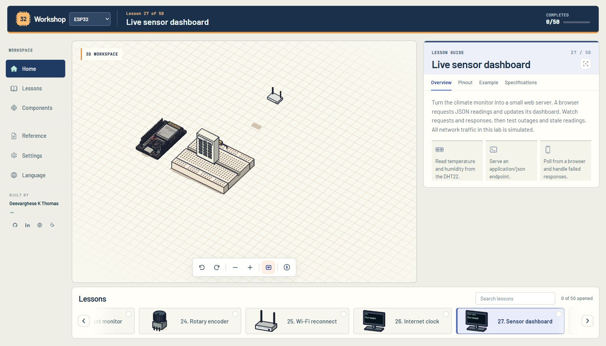</a> <strong>27. Live sensor dashboard</strong> Turn the climate monitor into a small web server. A browser requests JSON readings and updates its dashboard. Watch requests and responses, then test outages and stale readings. All network traffic in this lab is simulated. |
| <a href="screenshots/lessons/28-mqtt-publisher.jpg">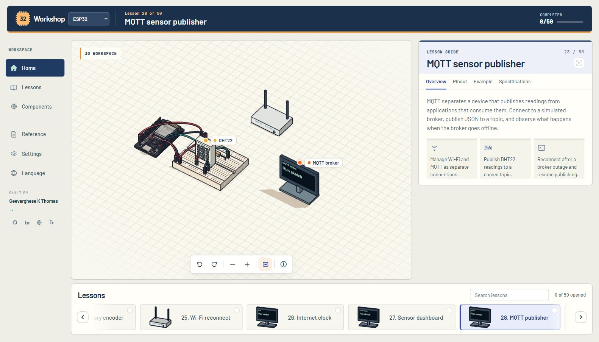</a> <strong>28. MQTT sensor publisher</strong> MQTT separates a device that publishes readings from applications that consume them. Connect to a simulated broker, publish JSON to a topic, and observe what happens when the broker goes offline. | <a href="screenshots/lessons/29-credential-security.jpg">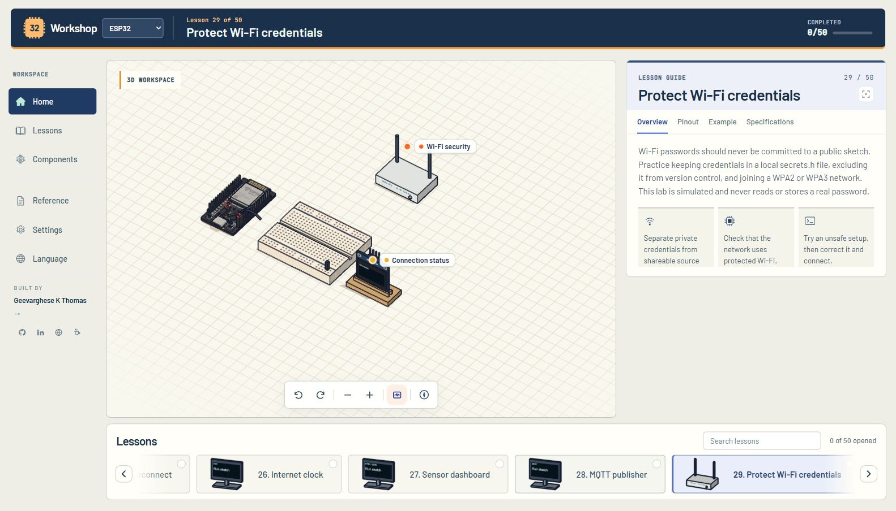</a> <strong>29. Protect Wi-Fi credentials</strong> Wi-Fi passwords should never be committed to a public sketch. Practice keeping credentials in a local secrets.h file, excluding it from version control, and joining a WPA2 or WPA3 network. This lab is simulated and never reads or stores a real password. | <a href="screenshots/lessons/30-https-certificates.jpg">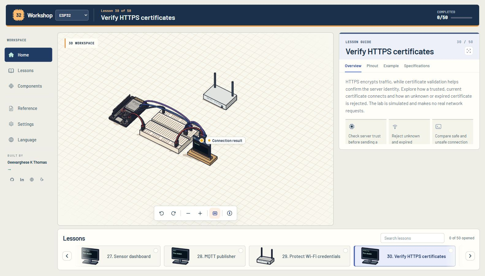</a> <strong>30. Verify HTTPS certificates</strong> HTTPS encrypts traffic, while certificate validation helps confirm the server identity. Explore how a trusted, current certificate connects and how an unknown or expired certificate is rejected. The lab is simulated and makes no real network requests. |
| <a href="screenshots/lessons/31-mqtt-access.jpg">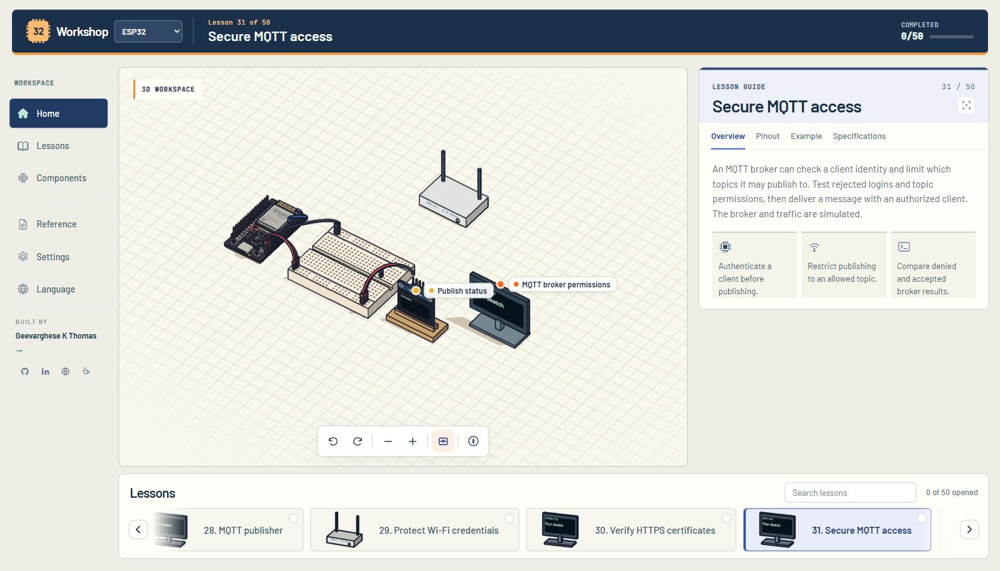</a> <strong>31. Secure MQTT access</strong> An MQTT broker can check a client identity and limit which topics it may publish to. Test rejected logins and topic permissions, then deliver a message with an authorized client. The broker and traffic are simulated. | <a href="screenshots/lessons/32-firmware-security.jpg">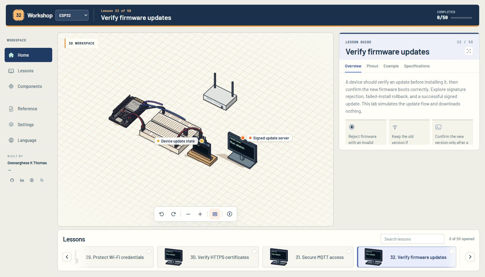</a> <strong>32. Verify firmware updates</strong> A device should verify an update before installing it, then confirm the new firmware boots correctly. Explore signature rejection, failed-install rollback, and a successful signed update. This lab simulates the update flow and downloads nothing. | <a href="screenshots/lessons/33-security-capstone.jpg">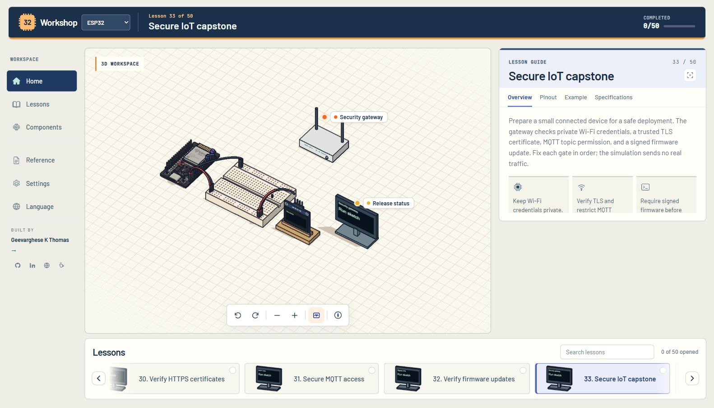</a> <strong>33. Secure IoT capstone</strong> Prepare a small connected device for a safe deployment. The gateway checks private Wi-Fi credentials, a trusted TLS certificate, MQTT topic permission, and a signed firmware update. Fix each gate in order; the simulation sends no real traffic. |
| <a href="screenshots/lessons/34-physical-security.jpg">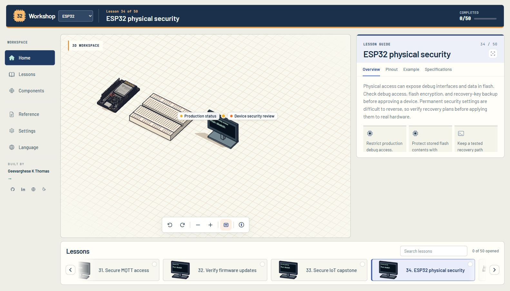</a> <strong>34. ESP32 physical security</strong> Physical access can expose debug interfaces and data in flash. Check debug access, flash encryption, and recovery-key backup before approving a device. Permanent security settings are difficult to reverse, so verify recovery plans before applying them to real hardware. | <a href="screenshots/lessons/35-wifi-scanner.jpg">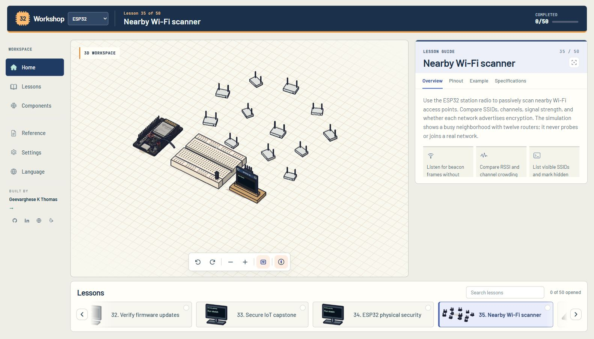</a> <strong>35. Nearby Wi-Fi scanner</strong> Use the ESP32 station radio to passively scan nearby Wi-Fi access points. Compare SSIDs, channels, signal strength, and whether each network advertises encryption. The simulation shows a busy neighborhood with twelve routers; it never probes or joins a real network. | <a href="screenshots/lessons/36-tft.jpg">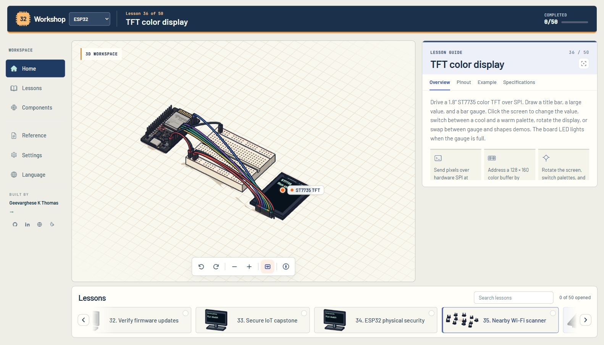</a> <strong>36. TFT color display</strong> Drive a 1.8" ST7735 color TFT over SPI. Draw a title bar, a large value, and a bar gauge. Click the screen to change the value, switch between a cool and a warm palette, rotate the display, or swap between gauge and shapes demos. The board LED lights when the gauge is full. |
| <a href="screenshots/lessons/37-seg7.jpg">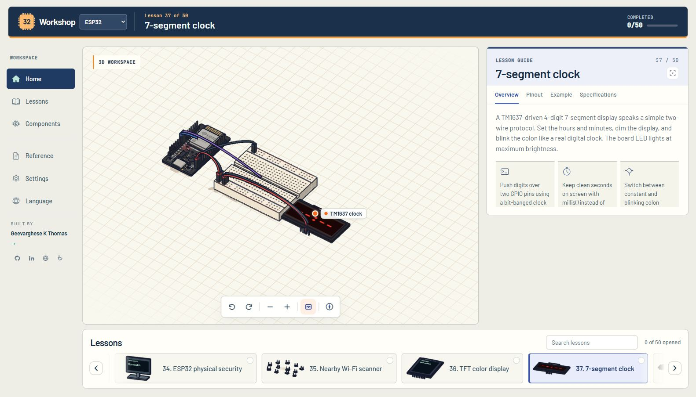</a> <strong>37. 7-segment clock</strong> A TM1637-driven 4-digit 7-segment display speaks a simple two-wire protocol. Set the hours and minutes, dim the display, and blink the colon like a real digital clock. The board LED lights at maximum brightness. | <a href="screenshots/lessons/38-neopixel.jpg">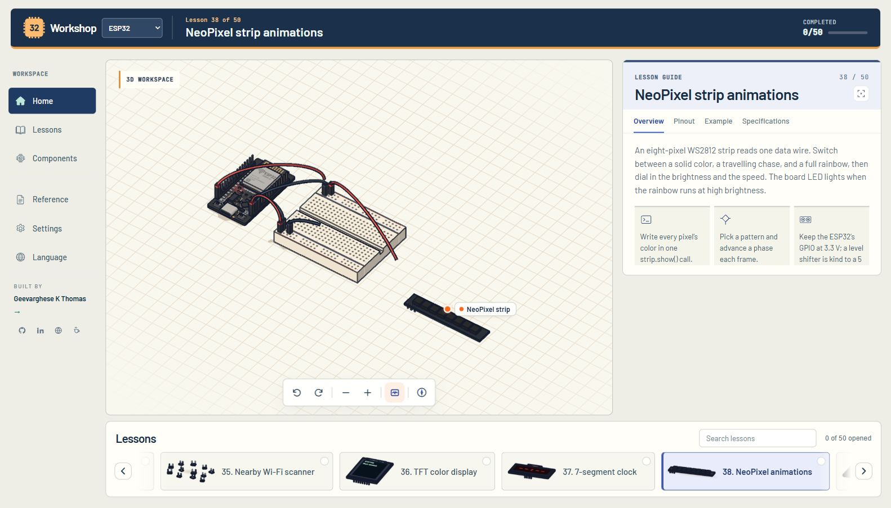</a> <strong>38. NeoPixel strip animations</strong> An eight-pixel WS2812 strip reads one data wire. Switch between a solid color, a travelling chase, and a full rainbow, then dial in the brightness and the speed. The board LED lights when the rainbow runs at high brightness. | <a href="screenshots/lessons/39-matrix.jpg">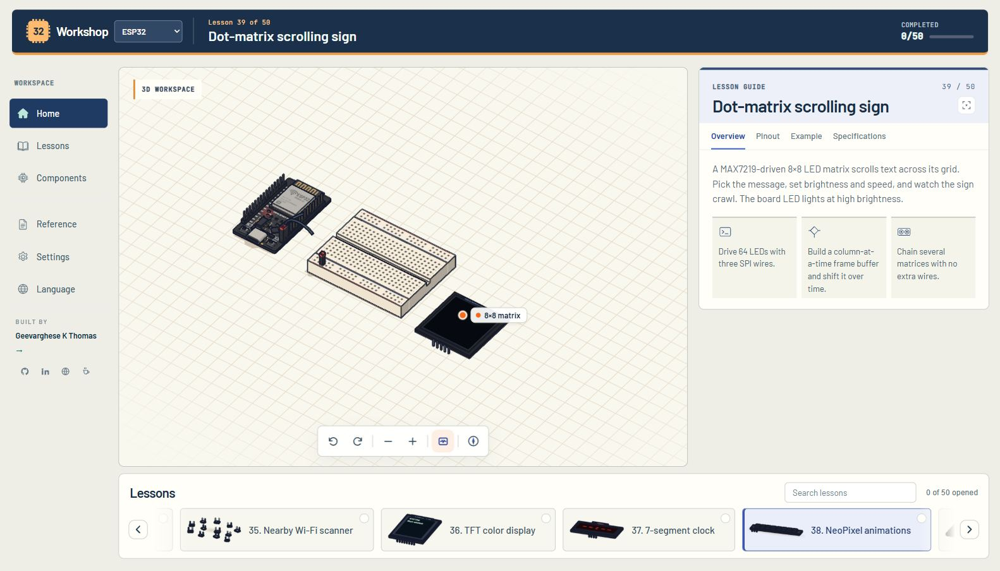</a> <strong>39. Dot-matrix scrolling sign</strong> A MAX7219-driven 8×8 LED matrix scrolls text across its grid. Pick the message, set brightness and speed, and watch the sign crawl. The board LED lights at high brightness. |
| <a href="screenshots/lessons/40-accel.jpg">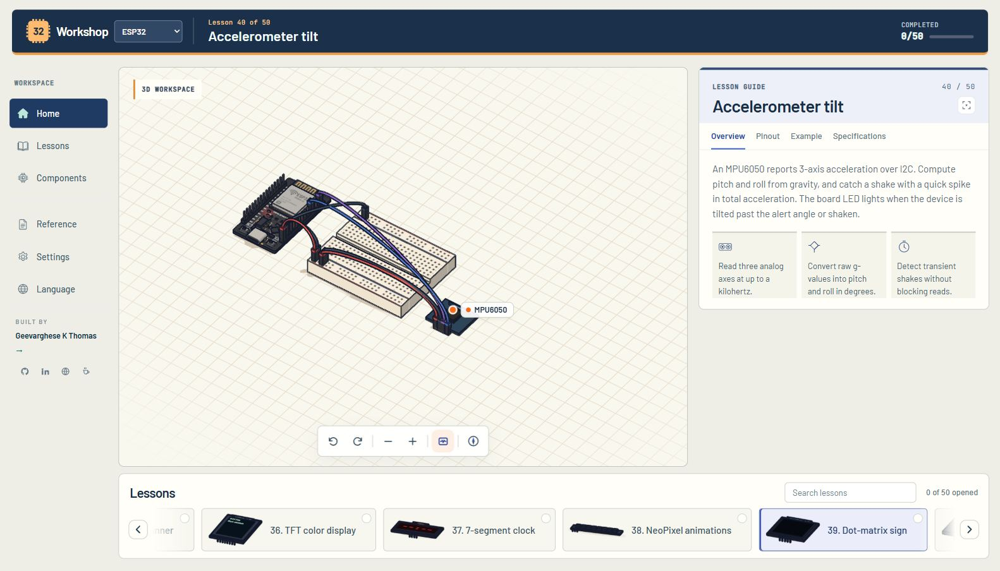</a> <strong>40. Accelerometer tilt</strong> An MPU6050 reports 3-axis acceleration over I2C. Compute pitch and roll from gravity, and catch a shake with a quick spike in total acceleration. The board LED lights when the device is tilted past the alert angle or shaken. | <a href="screenshots/lessons/41-airq.jpg">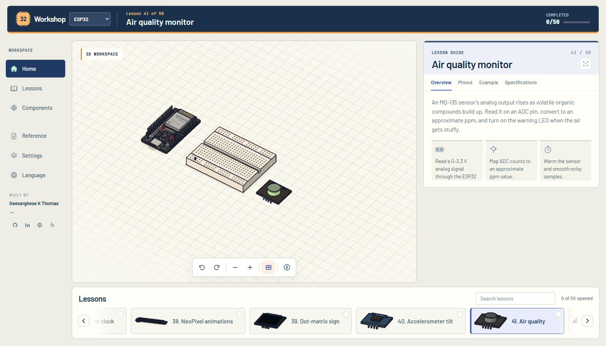</a> <strong>41. Air quality monitor</strong> An MQ-135 sensor’s analog output rises as volatile organic compounds build up. Read it on an ADC pin, convert to an approximate ppm, and turn on the warning LED when the air gets stuffy. | <a href="screenshots/lessons/42-rfid.jpg">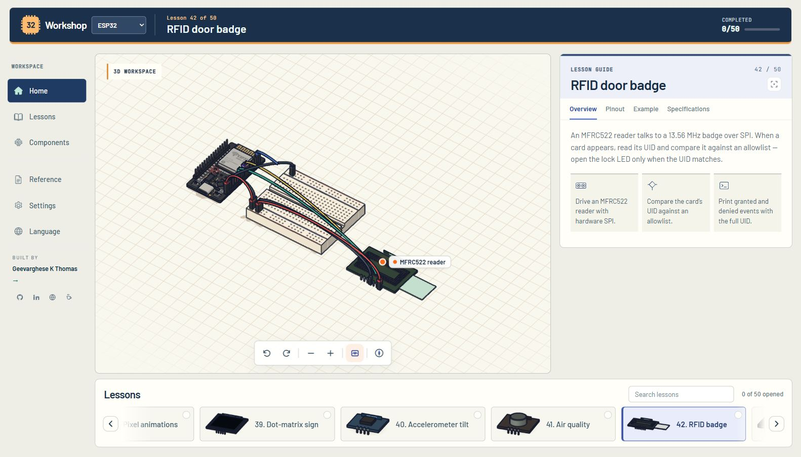</a> <strong>42. RFID door badge</strong> An MFRC522 reader talks to a 13.56 MHz badge over SPI. When a card appears, read its UID and compare it against an allowlist — open the lock LED only when the UID matches. |
|  <strong>43. Barometric altimeter</strong> A BMP280 reports atmospheric pressure over I2C. Compare it with the sea-level reference and compute altitude with the barometric formula. The board LED lights above the alert altitude. | <a href="screenshots/lessons/44-webhook-discord.jpg">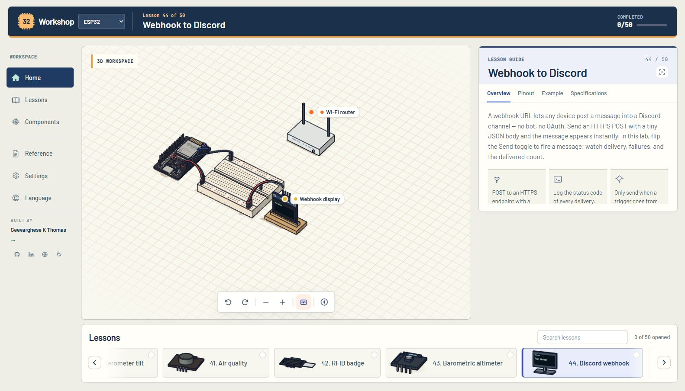</a> <strong>44. Webhook to Discord</strong> A webhook URL lets any device post a message into a Discord channel — no bot, no OAuth. Send an HTTPS POST with a tiny JSON body and the message appears instantly. In this lab, flip the Send toggle to fire a message; watch delivery, failures, and the delivered count. | <a href="screenshots/lessons/45-home-assistant.jpg">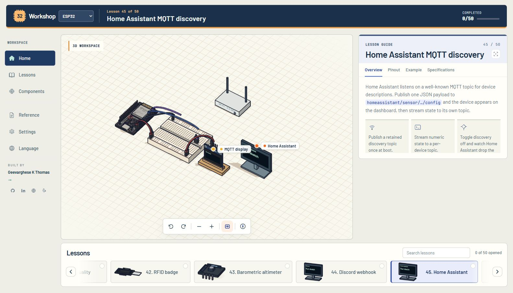</a> <strong>45. Home Assistant MQTT discovery</strong> Home Assistant listens on a well-known MQTT topic for device descriptions. Publish one JSON payload to <code>homeassistant/sensor/&hellip;/config</code> and the device appears on the dashboard, then stream state to its own topic. |
| <a href="screenshots/lessons/46-ota-update.jpg">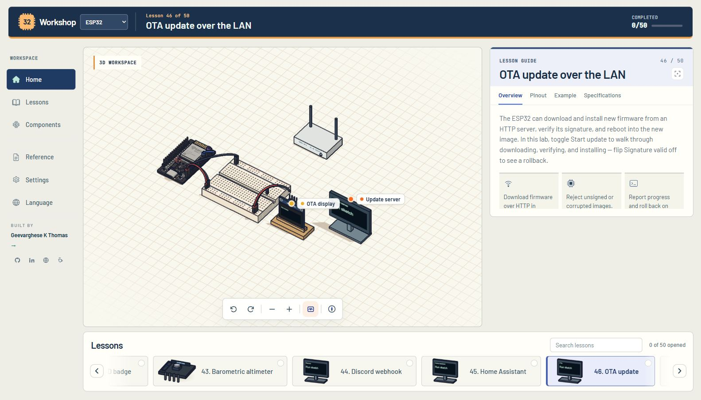</a> <strong>46. OTA update over the LAN</strong> The ESP32 can download and install new firmware from an HTTP server, verify its signature, and reboot into the new image. In this lab, toggle Start update to walk through downloading, verifying, and installing — flip Signature valid off to see a rollback. | <a href="screenshots/lessons/47-influxdb.jpg">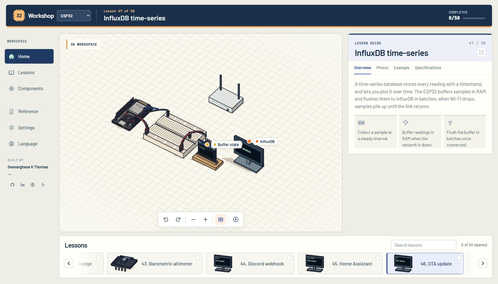</a> <strong>47. InfluxDB time-series</strong> A time-series database stores every reading with a timestamp and lets you plot it over time. The ESP32 buffers samples in RAM and flushes them to InfluxDB in batches; when Wi-Fi drops, samples pile up until the link returns. | <a href="screenshots/lessons/48-smart-mailbox.jpg">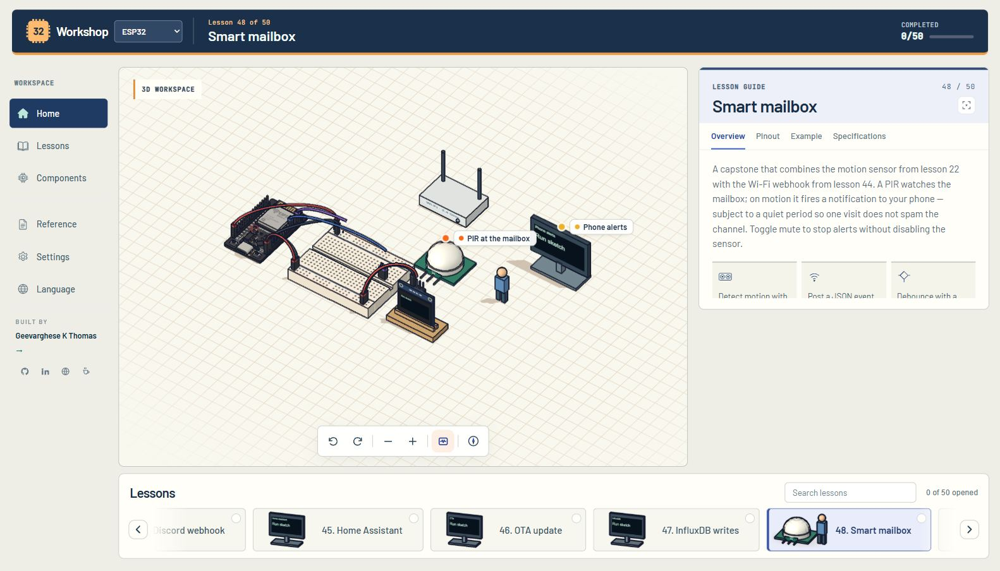</a> <strong>48. Smart mailbox</strong> A capstone that combines the motion sensor from lesson 22 with the Wi-Fi webhook from lesson 44. A PIR watches the mailbox; on motion it fires a notification to your phone — subject to a quiet period so one visit does not spam the channel. Toggle mute to stop alerts without disabling the sensor. |
| <a href="screenshots/lessons/49-plant-scheduler.jpg">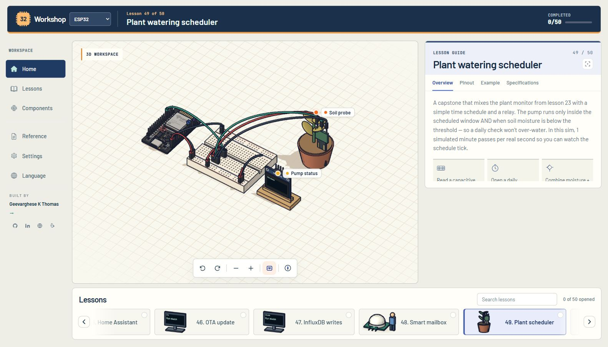</a> <strong>49. Plant watering scheduler</strong> A capstone that mixes the plant monitor from lesson 23 with a simple time schedule and a relay. The pump runs only inside the scheduled window AND when soil moisture is below the threshold — so a daily check won’t over-water. In this sim, 1 simulated minute passes per real second so you can watch the schedule tick. | <a href="screenshots/lessons/50-weather-station.jpg">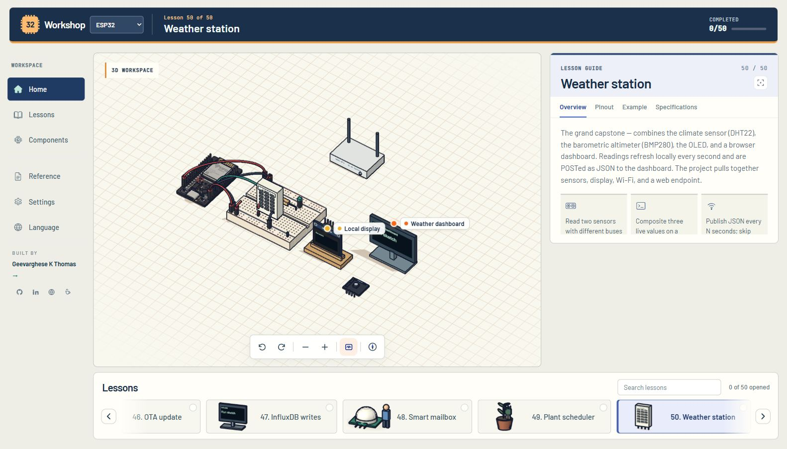</a> <strong>50. Weather station</strong> The grand capstone — combines the climate sensor (DHT22), the barometric altimeter (BMP280), the OLED, and a browser dashboard. Readings refresh locally every second and are POSTed as JSON to the dashboard. The project pulls together sensors, display, Wi-Fi, and a web endpoint. |  |
